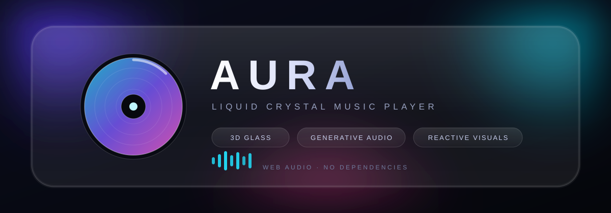

# AURA — Liquid Crystal Music Player

A 3D **liquid-crystal glass** music player that runs entirely in the browser.
No build step, no frameworks, no external audio files — the three built-in
ambient tracks are synthesised on the fly with the Web Audio API.



## Download

- **Android APK (landscape only):** [aura-1.0.0.apk](https://github.com/omxreedit/aura-liquid-glass-player/releases/latest/download/aura-1.0.0.apk)
- **Live web player:** https://omxreedit.github.io/aura-liquid-glass-player/

## Features

- **3D glass player** — pointer-reactive tilt with layered depth, glare and
  refraction highlights.
- **Liquid crystal disc** — animated conic gradients distorted through an SVG
  turbulence/displacement filter.
- **Generative ambient library** — 3 tracks (Neon Tide, Chrome Bloom, Glass
  Horizon) rendered offline with pads, bass, arpeggios, delay and convolution
  reverb, then encoded to WAV in the browser.
- **Reactive visualizer** — canvas bars driven by a real `AnalyserNode`, with a
  calm idle waveform when paused.
- **Full transport** — play/pause, previous/next, seek, volume, mute, shuffle
  and repeat (off / all / one).
- **Bring your own music** — add local audio via the file picker or drag & drop.
- **Extras** — keyboard shortcuts, Media Session lock-screen controls, dynamic
  colour themes per track, responsive layout, reduced-motion support.
- **Android app** — a 101 KB landscape-only WebView APK with immersive
  fullscreen, screen-awake and a native audio file picker.

## Run it

It's a static site. Open `index.html` directly, or serve the folder:

```bash
python3 -m http.server 8080
# then visit http://localhost:8080
```

## Android app (landscape only)

The `android/` folder contains a minimal WebView wrapper locked to
`sensorLandscape` — it never rotates to portrait, runs immersive fullscreen and
keeps the screen awake. The web player is bundled inside the APK, so it works
offline.

Build it on Termux:

```bash
pkg install openjdk-17 aapt aapt2 d8 apksigner curl
./android/build.sh
```

The signed APK lands in `release/aura-1.0.0.apk` (plus a `.sha256`). See
[`android/README.md`](android/README.md) for signing-key details and install
instructions.

## Keyboard shortcuts

| Key | Action |
| --- | --- |
| `Space` | Play / pause |
| `←` / `→` | Seek 5 seconds |
| `N` / `P` | Next / previous track |
| `M` | Mute |

## How the audio works

Each preset is rendered with `OfflineAudioContext` into a stereo buffer, then
converted to a 16-bit WAV `Blob` and played through a single `<audio>` element.
That element is routed into an `AnalyserNode`, so the same visualizer works for
both generated tracks and files you add.

## Tech

Vanilla HTML, CSS and JavaScript. No dependencies. Fonts (Manrope, Space
Grotesk) load from Google Fonts with system fallbacks.

## License

MIT
